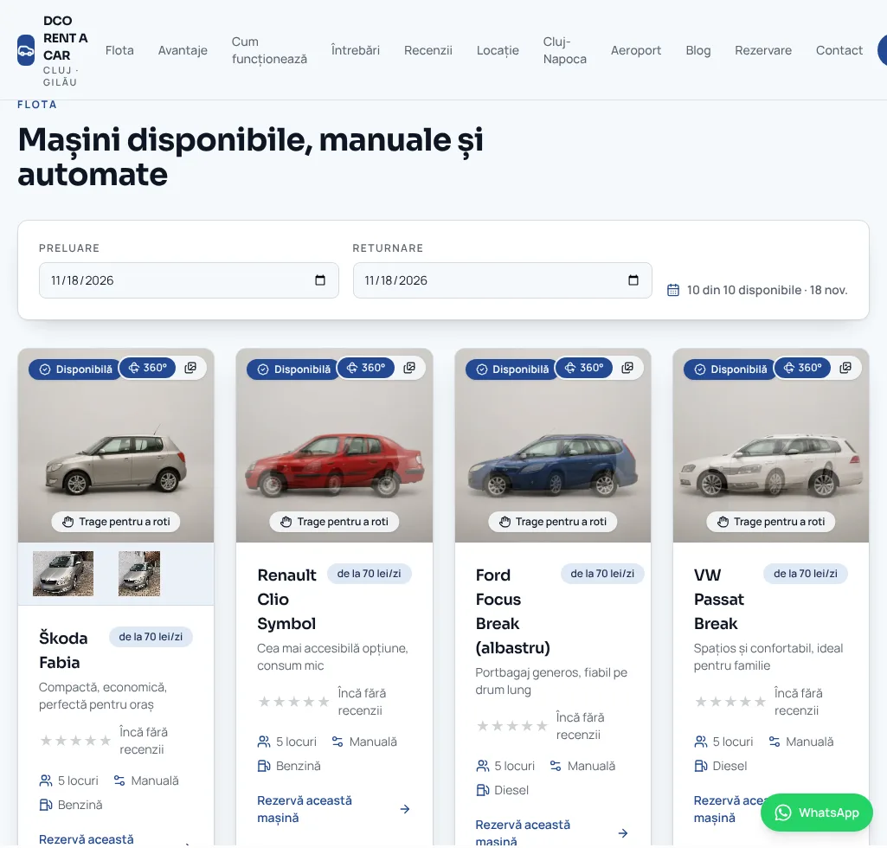

# DCO Rent a Car Cluj

Website for DCO Rent a Car, a car rental business in Gilău, Cluj: fleet with drag-to-rotate 360° views and real photos, live availability by date, online booking requests, local SEO landing pages and a blog.

**Live:** https://dcorentacarcluj.ro




## Stack

React 19, TanStack Start (SSR), Vite, Tailwind CSS, Supabase.

## Run locally

```bash
bun install
bun run dev
```

Then open http://localhost:3000. Supabase credentials are read from `.env`.

## Checks

```bash
bun run lint
bunx tsc --noEmit
bun test
bun run build
```

The same checks run on every pull request and on pushes to `main`.
